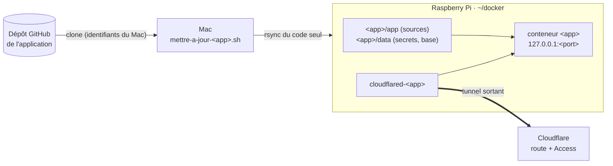

# Intégrer une nouvelle application depuis un dépôt GitHub

Guide de référence pour ajouter une application dont le code vit dans **son propre dépôt GitHub** au homelab (Raspberry Pi, Docker Compose, Cloudflare Tunnel). Le but : que **chaque application soit intégrée de la même manière**, donc qu'on puisse la mettre à jour, la protéger, la superviser et la restaurer sans réfléchir.

> Pour un simple site statique sans dépôt à part, voir plutôt [`ajouter-un-site.md`](ajouter-un-site.md). Ce guide-ci s'applique dès qu'il y a un **code à construire** (Node, Python, etc.).

## 1. Principe



Quatre règles tiennent tout le reste :

1. **Le code et les secrets ne se croisent jamais.** Le code vient de GitHub (copié par un script), les secrets et les données vivent dans `~/docker/<app>/data` sur le Pi, hors git, hors image.
2. **Le Pi n'a aucun accès au dépôt de l'application** (ou un accès en lecture seule par clé de déploiement, seulement si on veut un `git pull` sur le Pi). Le déploiement se fait **depuis le Mac**.
3. **Aucun port n'est ouvert sur la box.** Le conteneur n'écoute que sur `127.0.0.1` ; seul `cloudflared` le joint.
4. **Une application sans secrets démarre quand même, sans danger** (mode démo, page vide) : on ne branche les vrais accès qu'une fois la protection vérifiée.

## 2. Ce que le dépôt de l'application doit fournir

Un dépôt « prêt à héberger » respecte ce contrat. Ce n'est pas facultatif : c'est ce qui rend les scripts génériques.

| Exigence | Détail |
|---|---|
| **Écoute configurable** | variables `HOST` et `PORT` (défaut sûr : `127.0.0.1`) ; le conteneur choisit `0.0.0.0` en interne et publie sur la boucle locale |
| **Route de santé** | `GET /healthz` (ou à défaut `GET /`) qui répond 200 **sans appeler de service externe ni commander de matériel** |
| **Secrets hors du code** | lus depuis l'environnement, un fichier `*_FILE`, ou des chemins fixes redirigés vers `/data` ; **jamais** dans le dépôt, ni dans l'image, ni dans les logs |
| **Démarrage sans secrets** | mode démo explicite (le journal le dit : `MODE DÉMO`) plutôt qu'un plantage ou, pire, un accès sans protection |
| **Utilisateur non root, système de fichiers en lecture seule** | l'application n'écrit que dans `/data` (volume) et `/tmp` |
| **Journaux sur la sortie standard** | le pilote Docker les fait tourner ; jamais de fichier de log qui grossit sur la carte SD |
| **Un `Dockerfile`** (voir §5) | image légère (`node:22-alpine`, `python:3.x-slim`), arm64, dépendances figées |
| **Un `README.md`** | rôle, variables, secrets attendus, comment lancer en local (`npm run demo` ou équivalent) |
| **Tests (recommandé)** | une commande (`npm test`, `python -m unittest`) que le script de mise à jour lance **avant** de déployer ; sinon au minimum un contrôle de syntaxe |
| **Authentification : décision écrite** | le README dit si l'application s'authentifie elle-même. **Sans authentification propre, Cloudflare Access est la seule barrière** : à traiter comme tel (§4) |

Si l'application **commande du matériel** (ouvrants, serrures, robots, caméras…), ajouter deux choses : une route de lecture seule pour les tests de santé, et la mention explicite dans le README de ce qui ne doit **jamais** être appelé pour « tester ».

## 3. Conventions de nommage

Choisir **un nom court en minuscules** (`<app>`) et le garder partout. Éviter de faire diverger le nom du domaine et celui du conteneur.

| Élément | Convention | Exemple pour `<app>` |
|---|---|---|
| Domaine | `<app>.maximelabatut.com` | `exemple.maximelabatut.com` |
| Dossier sur le Pi | `~/docker/<app>/` avec `app/` (sources), `data/` (secrets et base, droits 700), `.version` (commit déployé) | `~/docker/exemple/app` |
| Service et conteneur | `<app>` | `exemple` |
| Image | `<app>:local` | `exemple:local` |
| Tunnel | service `cloudflared-<app>`, `network_mode: host` | `cloudflared-exemple` |
| Variable du token | `CLOUDFLARE_TUNNEL_TOKEN_<APP>` (majuscules), dans `.env` **et** vide dans `.env.example` | `CLOUDFLARE_TUNNEL_TOKEN_EXEMPLE` |
| Port | prochain port libre, publié sur `127.0.0.1` seulement (voir §3.1) | `127.0.0.1:8094:3000` |
| Script de mise à jour | `mac/mettre-a-jour-<app>.sh` (`--verifier`, `--force`) | `mac/mettre-a-jour-exemple.sh` |
| Dépôt local de travail | clone en cache : `~/.cache/homelab-jeux/<app>` | |

### 3.1 Choisir le port

Ne **jamais** deviner : relever les ports réellement en écoute sur le Pi.

```bash
ssh maxime@maxime.local "ss -lntH | awk '{print \$4}' | sort -u"
```

Prendre le plus petit port libre à partir de 8080 en tenant compte des ports déjà **déclarés** dans `docker-compose.yml` (un conteneur arrêté ne l'occupe pas, mais il le réclamera au redémarrage). Vérifier aussi que **personne d'autre n'est en train d'en prendre un** : plusieurs sessions de travail peuvent modifier le dépôt en parallèle.

## 4. Décisions à prendre avant de toucher à quoi que ce soit

### 4.1 Qui doit pouvoir l'ouvrir ?

| Niveau | Quand | Protection |
|---|---|---|
| **Public** | vitrine, jeux, page sans donnée ni action | aucune ; ajouter à `PUBLIC_HOSTS` |
| **Access, application partagée** | outils d'administration | politique commune, MFA |
| **Access, application dédiée, utilisateur seul, MFA** | application qui **agit sur le réel** ou lit des données privées | une application Access **par application**, politique « utilisateur seul » |
| **Access « semi-privé »** | partage avec quelques proches | application Access dédiée, code par e-mail, **jamais** sur une application qui agit sur le réel |
| **Local seulement** | outil sans authentification dont la compromission est grave | aucun tunnel, accès par tunnel SSH |

**Une même adresse ne peut appartenir qu'à une seule application Access.** Ne jamais rattacher une politique « semi-privé » à une application qui en protège une sensible.

### 4.2 Réseau Docker

- **Par défaut : réseau Docker standard**, port publié `127.0.0.1:<port>:<port interne>`. Les services d'un même compose se joignent par leur nom.
- **`network_mode: host` seulement si c'est indispensable** : découverte multicast (mDNS, Matter), ou besoin d'être vu comme `127.0.0.1` par une autre application. Conséquence : le port n'est plus « publié » (il écoute directement sur la machine), la sonde Uptime Kuma par nom ne marche plus, et la résolution `.local` dépend de l'hôte.
- Un nom `xxx.local` (mDNS) n'est **pas résolu** dans un réseau Docker par défaut : donner l'adresse IP (idéalement réservée dans la box internet).

### 4.3 Données et sauvegarde

Pour chaque donnée, décider **avant** : est-elle dans la sauvegarde quotidienne chiffrée, ou se reconstruit-elle ?

| Type | Sauvegarde ? | Au minimum |
|---|---|---|
| Base de données importante | oui (modifier `pi/homelab-backup`, **réinstaller avec `sudo`**) | instantané cohérent (`sqlite3 .backup`) |
| Base reconstructible (cache, catalogue) | non | documenter la commande de reconstruction |
| Secret re-générable (jeton d'API, session) | non, volontairement | documenter comment le recréer |
| Secret **non** re-générable | copie de référence hors du Pi (gestionnaire de mots de passe) | **dire où elle est** dans la doc privée |

Dans tous les cas, **écrire explicitement dans la documentation ce qui n'est pas sauvegardé**.

## 5. Gabarits

### 5.1 Dockerfile (dans le dépôt de l'application — recommandé)

```dockerfile
# <app> : <rôle en une ligne>. Aucun secret dans l'image : ils sont montés depuis /data.
FROM node:22-alpine
WORKDIR /app
COPY package*.json ./
RUN npm ci --omit=dev        # ou: aucune dépendance
COPY . .
USER node
ENV HOST=0.0.0.0 PORT=3000
EXPOSE 3000
HEALTHCHECK --interval=60s --timeout=10s --retries=3 --start-period=20s \
  CMD node -e "fetch('http://127.0.0.1:3000/healthz').then(r=>process.exit(r.ok?0:1)).catch(()=>process.exit(1))"
CMD ["node", "server.js"]
```

Variante Python : `FROM python:3.12-slim`, `useradd --uid 1000 app`, `pip install --no-cache-dir -r requirements.txt`, `USER app`, healthcheck avec `urllib.request`.

**Variante B — Dockerfile côté homelab** : si le dépôt n'a pas (ou ne veut pas) de `Dockerfile`, le placer dans `~/docker/<app>/Dockerfile` et l'appeler avec `build: { context: ./<app>/app, dockerfile: ../Dockerfile }`. Les secrets sont alors redirigés vers `/data` par des liens symboliques créés dans le `Dockerfile` (`ln -s /data/.env /app/.env`). C'est le seul cas où le `Dockerfile` est dans le dépôt du Pi.

### 5.2 Bloc `docker-compose.yml`

```yaml
  <app>:
    build:
      context: ./<app>/app            # + dockerfile: ../Dockerfile si variante B
    image: <app>:local
    container_name: <app>
    logging: *default-logging
    restart: unless-stopped
    mem_limit: 128m
    ports:
      - "127.0.0.1:<port>:<port interne>"
    environment:
      - HOST=0.0.0.0
      - PORT=<port interne>
    volumes:
      - ./<app>/data:/data            # :ro si l'application n'y écrit pas
    read_only: true
    tmpfs: [/tmp]                     # seulement si nécessaire
    cap_drop: [ALL]
    security_opt: ["no-new-privileges:true"]
    healthcheck:                      # inutile s'il est dans le Dockerfile
      test: ["CMD", "node", "-e", "fetch('http://127.0.0.1:<port interne>/healthz').then(r=>process.exit(r.ok?0:1)).catch(()=>process.exit(1))"]
      interval: 60s
      timeout: 10s
      retries: 3
      start_period: 20s

  cloudflared-<app>:
    image: cloudflare/cloudflared:latest
    container_name: cloudflared-<app>
    logging: *default-logging
    restart: unless-stopped
    network_mode: host
    command: tunnel run --token ${CLOUDFLARE_TUNNEL_TOKEN_<APP>}
```

Un commentaire d'en-tête au-dessus du bloc dit : rôle, dépôt source, où sont les secrets, ce qui n'est **pas** sauvegardé, et la **barrière de sécurité** (Access seul, mot de passe de l'application, etc.).

### 5.3 `.gitignore` et `.env.example` du dépôt du Pi

```gitignore
<app>/app/
<app>/data/
<app>/.version
```

```dotenv
CLOUDFLARE_TUNNEL_TOKEN_<APP>=
```

(La valeur n'entre **jamais** dans `.env.example` ni dans git.)

## 6. Procédure d'intégration, dans l'ordre

L'ordre compte : il garantit qu'à aucun moment l'application n'est joignable **sans** sa protection.

| # | Étape | Où | Qui |
|---|---|---|---|
| 1 | Vérifier le dépôt (§2), choisir nom, port, niveau d'accès, réseau, sauvegarde (§3-§4) | — | 🤖 |
| 2 | Créer le **tunnel** dans Cloudflare (Zero Trust → Networks → Tunnels) ; copier le **token** | navigateur | 👤 |
| 3 | Ajouter `CLOUDFLARE_TUNNEL_TOKEN_<APP>` dans `~/docker/.env` (le token n'est **pas** collé dans le chat) | Pi | 👤 |
| 4 | Variable vide dans `.env.example`, `.gitignore`, dossiers `<app>/app` et `<app>/data` (`chmod 700`) | Pi | 🤖 |
| 5 | Sauvegarder `docker-compose.yml` (`.bak-AAAAMMJJ-HHMMSS`), ajouter le bloc §5.2, `docker compose config -q` | Pi | 🤖 |
| 6 | Créer `mac/mettre-a-jour-<app>.sh` (§7) et le lancer : l'application démarre **en mode démo**, sur `127.0.0.1` | Mac | 🤖 |
| 7 | Démarrer le tunnel : `docker compose up -d --no-deps cloudflared-<app>` (l'assistant Cloudflare attend « Connected ») | Pi | 🤖 |
| 8 | Créer la **route publique** du tunnel : `<app>.maximelabatut.com` → `http://localhost:<port>` | navigateur | 👤 |
| 9 | Créer l'**application Access** de ce nom d'hôte (politique choisie en §4.1) | navigateur | 👤 |
| 10 | **Vérifier la protection** : `curl -s -o /dev/null -w "%{http_code} %{redirect_url}\n" https://<app>.maximelabatut.com/` → **302 vers `cloudflareaccess.com`**, **y compris en `POST`** | Mac | 🤖 |
| 11 | Seulement alors : déposer les **secrets** dans `~/<app>/data` (saisis au clavier par l'utilisateur, jamais dans un chat), redémarrer le conteneur, vérifier que le mode démo a disparu | Pi | 👤 |
| 12 | Essai en conditions réelles **par l'utilisateur** (jamais d'appel d'écriture « pour tester ») | navigateur | 👤 |
| 13 | Supervision, restauration, documentation (§8 à §10) | dépôt du Pi, docs | 🤖 |

Notes :
- À l'étape 8, **ne pas sonder le nom** avant que la route existe : macOS garde en cache « Could not resolve host » et le site paraît en panne pendant des minutes.
- Si l'étape 9 est faite après le 8, la fenêtre est courte, mais l'application est **en mode démo** et inoffensive : c'est tout l'intérêt de la règle n°4.
- Un nom d'hôte tout juste créé peut rester « non vérifié » quelques secondes côté Pi.

## 7. Script de mise à jour (`mac/mettre-a-jour-<app>.sh`)

Chaque application a **le même script**, copié du plus récent (prendre le plus récent du dossier `mac/`) et adapté par remplacement. Il offre toujours les mêmes options :

```bash
mac/mettre-a-jour-<app>.sh              # met à jour si GitHub a de nouveaux commits
mac/mettre-a-jour-<app>.sh --verifier   # dit seulement si le Pi est à jour
mac/mettre-a-jour-<app>.sh --force      # reconstruit et redéploie même sans changement
```

Les étapes sont toujours les mêmes, dans cet ordre :

1. **Cloner ou mettre à jour** le dépôt dans `~/.cache/homelab-jeux/<app>` (`git fetch` + `reset --hard origin/main`).
2. **Comparer** le commit au fichier `~/docker/<app>/.version` du Pi ; « Déjà à jour » et arrêt si identique.
3. **Tester** : suite de tests si elle existe, sinon contrôle de syntaxe. **Un échec annule tout** (rien n'est modifié sur le Pi).
4. **Copier** uniquement le nécessaire à l'exécution (`rsync -a --delete`) dans `~/docker/<app>/app/` : **jamais** `.env`, `data/`, clés, bases ni fichiers de session.
5. **Construire** l'image (`docker compose build <app>`).
6. **Relancer** seulement ce conteneur (`docker compose up -d --no-deps <app>`) : ni les autres ni le tunnel ne sont touchés.
7. **Attendre « healthy »** (30 essais) et contrôler `127.0.0.1:<port>/healthz` ; dire si l'application est en **mode démo**.
8. **Écrire `.version`** seulement en cas de succès.

À remplacer en copiant : `HOST` (variable d'environnement), `REPO`, `CACHE`, `DEST`, les fichiers copiés par `rsync`, la commande de test, le nom du service, le port, la route de santé.

Variantes déjà utilisées : tests dans un **conteneur jetable sans réseau** sur le Pi avant de toucher au service, et **retour arrière automatique** vers l'image précédente si le nouveau conteneur n'est pas sain (utile pour les applications sensibles). Les ajouter ne change pas l'interface du script.

## 8. Supervision et contrôle d'exposition

- **`pi/verifier-acces.sh`** : ajouter le sous-domaine à `PROTECTED_HOSTS` (ou `PUBLIC_HOSTS`). Puis recopier la version installée, lue par la sauvegarde quotidienne (**commande `sudo`, lancée par l'utilisateur**) :
  ```bash
  sudo install -m 755 -o root -g root ~/docker/pi/verifier-acces.sh /usr/local/sbin/homelab-check-access
  ```
- **Dashboard** (`dashboard/html/index.html`, fichier du dépôt public) : une entrée dans `APPS` (identifiant, nom, URL, membres : conteneur + tunnel) et des descriptions **génériques** dans `DESCRIPTIONS` (pas de nom de dépôt privé, pas de détail sensible).
- **Uptime Kuma** : sonde sur `http://<app>:<port interne>/` **par le nom Docker** (jamais l'URL publique : Access répondrait par sa page de connexion). Impossible en `network_mode: host` : le noter.
- **Alertes** : si l'application commande du matériel, ne **jamais** sonder une route qui agit.

## 9. Restauration de la carte SD

Une application qui n'est pas dans ces scripts **disparaît** après une panne. À modifier systématiquement :

| Fichier | Quoi |
|---|---|
| `restore.sh` | `mkdir -p` de `<app>/app` et `<app>/data` ; `chmod 700` de `<app>/data` ; **règle `SKIP`** : `[ -f <app>/app/<fichier clé> ] \|\| SKIP="$SKIP <app>"` (un seul dossier de build absent fait échouer **tout** `docker compose up -d`) ; message de fin : quoi refaire pour cette application |
| `mac/restaurer-pi.sh` | ligne de redéploiement `SSH_KEY_FILE="$SSHKEY" "$HERE/mettre-a-jour-<app>.sh" --force || echo "…à relancer plus tard…"`, rappel en fin de script de ce qui n'est pas sauvegardé |
| `docs/restauration-carte-sd.md`, `docs/restauration-pas-a-pas.md` | liste du script de redéploiement, nombre de tokens et de conteneurs, **ce qui n'est pas sauvegardé et comment le recréer** |

Le token du tunnel est dans `.env`, donc dans l'archive chiffrée : le tunnel redémarre tout seul après restauration et répond **502** jusqu'au redéploiement du code. C'est normal.

`restore.sh` est récupéré depuis la branche `main` de GitHub : **un correctif n'est actif qu'une fois poussé**.

## 10. Documentation à mettre à jour

À chaque nouvelle application, dans cet ordre (le dépôt **privé** d'abord, le public ne reçoit que la version générique) :

- [ ] Section de l'application dans la doc d'exploitation privée (rôle, tableau conteneur / tunnel / port / sources / secrets, mise en service, pièges, mise à jour, restauration, limites).
- [ ] Cartographie de l'infrastructure (diagramme, tableau par service, ports en écoute, dépendances, éléments non sauvegardés, comptes de tokens et de tunnels).
- [ ] Restauration (§9).
- [ ] Fichier de contexte du poste de travail (`CLAUDE.md`) : ligne du tableau des applications, prochain port libre, comptes de tokens.
- [ ] Copie locale du `.env` rafraîchie (14, 15… tokens ; noms seulement, jamais les valeurs).
- [ ] Doc publique : seulement ce qui est **générique** (dashboard, `verifier-acces.sh`, diagramme des familles de services).
- [ ] **Avant de pousser vers le dépôt public** : chercher `eyJ|token=|password|secret` dans le diff.

## 11. Définition de « terminé »

Une application est intégrée quand **toutes** les cases sont cochées :

- [ ] Conteneur `healthy`, port sur `127.0.0.1` uniquement, non root, lecture seule.
- [ ] Tunnel connecté ; route créée ; application Access en place ; **302 vérifié en `GET` et en `POST`**.
- [ ] Secrets déposés par l'utilisateur ; mode démo disparu ; essai réel fait par l'utilisateur.
- [ ] `mac/mettre-a-jour-<app>.sh` fonctionne (`--verifier` puis une vraie mise à jour).
- [ ] `verifier-acces.sh` à jour **et recopié** (`sudo`) ; le contrôle indique « Tout est conforme ».
- [ ] Entrée dans le dashboard ; sonde Uptime Kuma (ou raison de son absence).
- [ ] `restore.sh`, `restaurer-pi.sh` et docs de restauration à jour ; non-sauvegardé explicitement listé.
- [ ] Documentation (§10) à jour ; commits faits ; **push seulement sur demande**.

## 12. Pièges rencontrés

| Symptôme | Cause et remède |
|---|---|
| `bind: address already in use` ou service sans réponse | port déjà pris (parfois par une autre session de travail pendant la même heure) : relire `ss -lnt` et `docker-compose.yml` juste avant d'écrire |
| 502 sur le nouveau domaine | le service n'écoute pas encore, ou le port de la route Cloudflare n'est pas celui du conteneur |
| « Could not resolve host » alors que `dig` répond | cache DNS négatif de macOS : `sudo dscacheutil -flushcache; sudo killall -HUP mDNSResponder` (par l'utilisateur), navigation privée ; **ne pas sonder le nom avant la route** |
| « Unable to find your Access application » | lien de connexion périmé dans un onglet ou l'historique : navigation privée |
| `destination belongs to another application` | l'adresse est déjà protégée par une autre application Access : une application Access **par** adresse |
| `Restarting (1)` en boucle | démarrage avant les secrets : n'exiger de secrets qu'en production, sinon mode démo |
| `docker compose up -d` échoue pour **tous** les services | un contexte de build est absent : règle `SKIP` de `restore.sh` |
| Dossier créé en `root`, 403 ou erreur d'écriture | Docker a créé le dossier monté : le créer soi-même **avant** le premier démarrage |
| `getaddrinfo ENOTFOUND xxx.local` | mDNS non résolu dans le réseau Docker : utiliser l'adresse IP |
| Le partage SMB `/Volumes/docker` montre l'ancienne version d'un fichier | cache : lancer la copie locale ou comparer avec `ssh … cat` |
| `docker logs` s'arrête avant la fin | lire le fichier de journal brut du conteneur |
| Application « en panne » qui ne l'est pas | la sonde appelle l'URL publique (Access répond 302) : sonder par le nom Docker |
| Pièces ou configuration perdues après une panne | `<app>/data` n'était pas sauvegardé : c'était à écrire dans la doc (§4.3) |

## 13. Règles de sécurité à respecter

- **Aucun secret** (token, mot de passe, clé, code de jumelage) dans git, dans une doc publique, dans l'image, dans les journaux, ni **collé dans une conversation**. Vérifier une longueur ou un nom de variable, pas une valeur. L'utilisateur saisit les secrets sur le Pi (`read -rs`).
- **Jamais de requête d'écriture « pour tester »** sur une application qui commande du matériel (ouvrants, serrures, robots, caméras…) : seules les routes de lecture documentées sont permises ; les tests automatiques utilisent de **faux services**.
- **Une application sans authentification propre n'est jamais ouverte** sans Access dédiée (utilisateur seul, MFA).
- **Les outils d'administration** (Docker, journaux) restent sur la boucle locale ou derrière Access.
- **Confirmer avant** d'écrire dans un dépôt public, de pousser, de créer des comptes ou d'ouvrir un accès : la règle est « commit sur demande, push seulement quand l'utilisateur dit « pousse » ».
